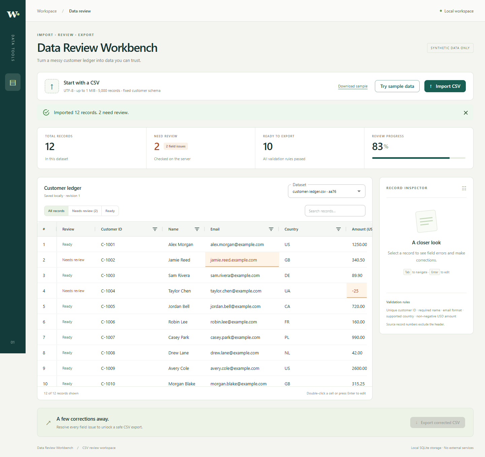

# Data Review Workbench

Import a customer ledger, fix field errors, and download a spreadsheet-safe CSV. Your saved corrections stay on your computer and survive a restart.



## Open the ready-to-run demo

**Windows x64:** [Download DataReviewWorkbench-1.0.0.exe](https://github.com/DartOrange/data-review-workbench/raw/refs/heads/main/demo/windows-x64/DataReviewWorkbench-1.0.0.exe), or open the copy in [`demo/windows-x64`](demo/windows-x64).

1. Double-click **DataReviewWorkbench-1.0.0.exe**.
2. Your browser opens **http://127.0.0.1:3001**. Keep the console window open while using the app.
3. Press **Ctrl+C** or close the console window to stop it.

No Node.js, npm, database installation, account, or API key is needed. The executable includes the application and runtime. It is unsigned; Windows may show a publisher warning. The app binds only to your computer's loopback address.

Saved datasets are stored in `%LOCALAPPDATA%\DataReviewWorkbench\workbench.sqlite`. Moving or replacing the executable does not remove them. If port 3001 is occupied, close the other app instance before starting another.

## Try it in three minutes

1. Click **Try sample data**, or import [customer-ledger.csv](public/samples/customer-ledger.csv). It contains 12 synthetic records and two field errors.
2. Select **Needs review (2)**. Double-click Jamie Reed's email, enter `jamie.reed@example.com`, and press Enter.
3. Select record 4. In the inspector, change **Amount (USD)** from `-25` to `25.00`, then click **Save record**.
4. Reload the page or restart the application. Both corrections remain saved.
5. Click **Export corrected CSV**. The download includes your corrections and spreadsheet formula protection.

Import [malformed.csv](public/samples/malformed.csv) to see a rejected upload. Your existing saved dataset remains intact.

## Review with confidence

- Server validation highlights individual fields and reports precise errors in the record inspector.
- Filter records by review status, search values, sort columns, and reopen earlier imports.
- Edit directly in the grid or save several fields together in the inspector.
- Use Tab/arrow keys to navigate, Enter to edit or commit, and Escape to cancel a grid edit.
- A failed form save retains your draft. A stale tab cannot overwrite a newer saved revision.
- Export unlocks when every record passes validation. Quoted CSV output neutralizes formula-like values without changing saved source data.

More views: [field inspector](docs/screenshots/01b-inspector.png), [corrected dataset](docs/screenshots/02-corrected.png), [upload error](docs/screenshots/03-malformed.png).

## Supported CSV

Use UTF-8 and these exact headers in this order:

```csv
customer_id,name,email,country,amount,notes
```

| Field         | Rule                                                           |
| ------------- | -------------------------------------------------------------- |
| `customer_id` | Unique; 2–24 uppercase letters, digits, or hyphens             |
| `name`        | Nonblank                                                       |
| `email`       | Valid email format                                             |
| `country`     | US, GB, DE, UA, CA, FR, PL, or NL                              |
| `amount`      | 0–9999999.99 USD; up to two decimal places; no currency symbol |
| `notes`       | Optional text, up to 1,000 characters                          |

Other fields allow up to 256 characters. Uploads are limited to **1 MiB** and **5,000 records**. Quoted commas, escaped quotes, multiline text, CRLF, and UTF-8 BOM are supported. Broken quoting, inconsistent columns, unsupported encoding, and empty files are rejected before saving.

This is a local, single-user application with a fixed schema. Email checks validate format only. Export prefixes formula-like cells with an apostrophe; behavior in individual spreadsheet programs has not been certified.

## Build and development

See [development setup](docs/DEVELOPMENT.md), [architecture and API](docs/ARCHITECTURE.md), and [verified behavior](docs/VERIFICATION.md).

MIT licensed. See [LICENSE](LICENSE), [third-party notices](THIRD_PARTY_NOTICES.md), and the runtime/dependency notices alongside the executable.
