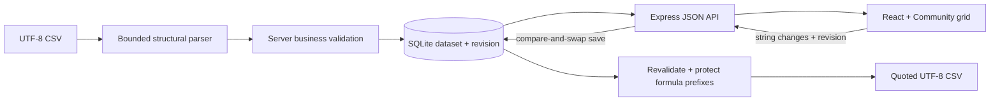

# Architecture and API

## Data flow

## Storage model

`datasets(id, name, created_at, revision, payload)` stores one JSON array of string-valued records per import. Import uses one atomic INSERT after successful structural parsing. A save reads the current dataset, checks the submitted revision, applies a bounded patch, and performs one atomic UPDATE with `WHERE revision = ?`. A mismatched revision returns 409. WAL and a 3-second busy timeout support SQLite's local file lifecycle; they are not a promise of multi-user scalability.

Validation results are derived, not duplicated in storage. `customer_id` is user-editable data; the UI's stable row ID is the original 1-based record ordinal. A dataset UUID distinguishes separate imports, even when filenames repeat. Dataset revision increments after every accepted patch, including patches that leave business-invalid values.

Each response includes all rows and their current issues. Revalidation is O(n) and also updates cross-row uniqueness errors. The JSON payload trades normalized queries and fine-grained updates for a very small schema. There is no schema migration system in this first release.

## API

| Method and route                      | Contract                                                                                     |
| ------------------------------------- | -------------------------------------------------------------------------------------------- |
| `GET /api/health`                     | Local process readiness                                                                      |
| `GET /api/datasets`                   | Dataset summaries, newest first                                                              |
| `POST /api/datasets`                  | Raw `text/csv` body; optional URI-encoded `X-File-Name`; returns 201 and dataset             |
| `GET /api/datasets/:id`               | Dataset, revision, records, and derived field issues                                         |
| `PATCH /api/datasets/:id/rows/:rowId` | JSON `{ "revision": 1, "changes": { "email": "jamie@example.com" } }`; returns saved dataset |
| `GET /api/datasets/:id/export`        | Download validated CSV; 422 if any field issue remains                                       |

Dataset response: `{ id, name, createdAt, revision, total, invalid, issueCount, rows }`. Row response: `{ id, values, issues }`. `issues` maps field names to human-readable messages. Field names and TypeScript types live in `shared/contracts.ts`; runtime validation remains on the server.

Error responses have `{ code, message }`. Important statuses: 400 (malformed input), 403 (cross-origin mutation), 404 (missing dataset/row), 409 (revision conflict), 413 (limits), 415 (unsupported upload content type), 422 (export blocked), 500 (unexpected server failure). PATCH accepts known string fields only, with a 16 KiB JSON-body limit and 4,000-character transport cap per value; business validation applies the tighter field limits. Unknown fields, numeric values, empty patches, invalid revisions, and malformed JSON fail before mutation.

## UI state and recovery

- SQLite is the source of truth. The grid receives server-confirmed rows; no failed request can appear as a successful local correction.
- One in-flight operation is allowed per page. Editing and import controls are disabled while it runs. JSON and export requests have 15-second browser timeouts.
- A form draft stays local until explicit save. Failed saves retain the draft. Selecting another record/import or reloading saved data asks to discard unsaved changes; page unload uses the browser's draft warning.
- Filtering and search affect the displayed rows, not the stored dataset or export contents.
- localStorage stores only the selected dataset ID. If unavailable, the latest dataset is used; record values are never dependent on browser storage.
- A timeout may occur after the server committed a request. Reloading saved data resolves uncertain outcomes. The UI does not automatically replay failed writes.
- The error banner's recovery action reloads server state. A conflict retains the draft until the user explicitly discards it, reloads, and reapplies a correction.

## File and spreadsheet boundaries

The parser rejects invalid UTF-8 and structural CSV errors before persistence. Field values remain strings to avoid rounding, stripping leading zeroes, or silently repairing data. Duplicate IDs flag every affected row. All fields, including notes, participate in length/control-character validation.

Export revalidates current persisted records and refuses unresolved issues. CSV quoting protects structure; apostrophe prefixes address formula-like strings separately. Prefixing is visible data transformation, not a claim that all spreadsheet applications behave identically. Stored values remain untouched. No formula evaluation or spreadsheet import is implemented.

The application binds only to loopback and rejects browser mutations from unlisted origins. It has no CORS enablement, credentials, authentication, or paid integrations. Runtime databases and test artifacts are ignored. This is a local tool for synthetic datasets, not a hosted service or a privacy/security certification.
